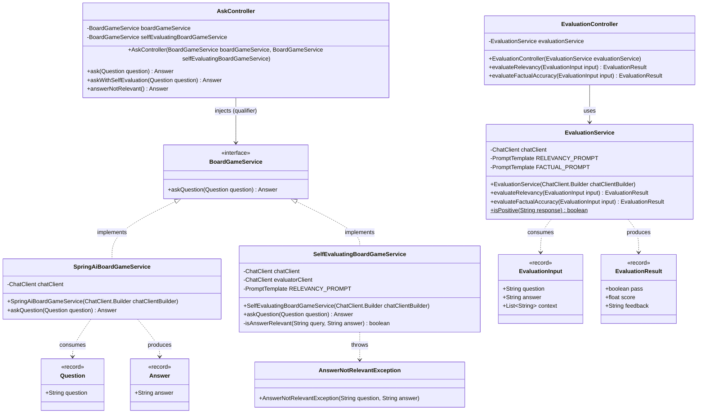

# LAPORAN PRAKTIKUM SPRING AI IN ACTION
## IMPLEMENTASI CHAPTER 1 & CHAPTER 2: BOARD GAME BUDDY

* **Mata Kuliah / Praktikum:** Integrasi AI / Rekayasa Perangkat Lunak Berbasis AI
* **Buku Referensi:** *Spring AI in Action* oleh Craig Walls
* **Dosen Pengampu:** Rizal Broer (`rizalbroer@uinjkt.ac.id`)
* **Nama Mahasiswa:** Dibaj
* **Repositori GitHub:** [https://github.com/babaj-dibaj/dibaj-board-game-buddy](https://github.com/babaj-dibaj/dibaj-board-game-buddy)

---

## DAFTAR ISI
1. [BAB I: Pemahaman Teori, Manfaat, Kelebihan, dan Kekurangan](#bab-i-pemahaman-teori-manfaat-kelebihan-dan-kekurangan)
2. [BAB II: Konfigurasi, Instalasi, Paket, dan Server](#bab-ii-konfigurasi-instalasi-paket-dan-server)
3. [BAB III: Perancangan Arsitektur dan Kode Program (UML)](#bab-iii-perancangan-arsitektur-dan-kode-program-uml)
4. [BAB IV: Dokumentasi Hasil Pengujian Eksperimen & Praktikum](#bab-iv-dokumentasi-hasil-pengujian-eksperimen--praktikum)
   - [Eksperimen 1: Chapter 1 — Tanya Jawab Aturan Game (ChatClient)](#eksperimen-1-chapter-1--tanya-jawab-aturan-game-chatclient)
   - [Eksperimen 2: Chapter 2 — Self-Evaluating Board Game Service](#eksperimen-2-chapter-2--self-evaluating-board-game-service)
   - [Eksperimen 3: Chapter 2 — Evaluasi Relevansi Jawaban (Relevancy Evaluator)](#eksperimen-3-chapter-2--evaluasi-relevansi-jawaban-relevancy-evaluator)
   - [Eksperimen 4: Chapter 2 — Verifikasi Akurasi Faktual (Fact-Checking Evaluator)](#eksperimen-4-chapter-2--verifikasi-akurasi-faktual-fact-checking-evaluator)
5. [BAB V: Publikasi dan Versioning GitHub](#bab-v-publikasi-dan-versioning-github)
6. [BAB VI: Panduan Rekaman Live Demo Video](#bab-vi-panduan-rekaman-live-demo-video)

---

## BAB I: PEMAHAMAN TEORI, MANFAAT, KELEBIHAN, DAN KEKURANGAN

### 1.1 Teori Dasar Spring AI
Spring AI merupakan framework aplikasi yang dirancang untuk mempermudah integrasi kemampuan Artificial Intelligence (khususnya *Generative AI* dan *Large Language Models / LLM*) ke dalam aplikasi berbasis Java Enterprise dan Spring Boot. 

Sebelum adanya Spring AI, pengembang Java harus menulis panggilan HTTP manual ke API penyedia AI (OpenAI, Anthropic, Google, dll.) yang menghasilkan kode yang sangat terikat (*tightly coupled*) pada vendor tertentu. Spring AI mengadopsi filosofi desain Spring Framework: **abstraksi portabel**, **Dependency Injection**, dan **komposabilitas modular**.

Komponen inti yang dipelajari pada Chapter 1 dan 2:
1. **`ChatModel` & `ChatClient`**: Abstraksi tingkat tinggi untuk berinteraksi secara deklaratif dengan model LLM. `ChatClient` menyediakan fluent API untuk menyusun system prompt, user prompt, memanggil model (`call()`), dan memetakan output secara terstruktur.
2. **Evaluasi Respons AI (Chapter 2)**: Karakteristik utama LLM adalah sifat non-deterministik dan potensi halusinasi. Chapter 2 memperkenalkan teknik evaluasi otomatis (*LLM-as-a-judge*):
   - **Relevancy Evaluation**: Mengukur apakah jawaban yang dihasilkan benar-benar menjawab pertanyaan pengguna dalam koridor konteks.
   - **Fact-Checking Evaluation**: Memverifikasi apakah klaim dalam respons didukung secara faktual oleh dokumen acuan (*grounded factuality*).
   - **Self-Evaluation dengan Resilient Retry**: Pola arsitektur di mana servis AI memvalidasi responsnya sendiri sebelum dikirim ke pengguna, dan melakukan *retry* otomatis jika respons dinilai tidak relevan.

### 1.2 Manfaat
- **Portabilitas Vendor**: Kode aplikasi ditulis terhadap antarmuka Spring AI (`ChatClient`, `ChatModel`). Penggantian model dari OpenAI ke model lokal (Ollama / Llama 3.2) dapat dilakukan hanya dengan mengubah konfigurasi dependensi dan `application.properties` tanpa merombak logika bisnis.
- **Kualitas & Keamanan Respons**: Melalui implementasi Chapter 2, aplikasi memiliki gerbang kendali kualitas (*quality gate*) otomatis terhadap halusinasi dan penyimpangan konteks.
- **Efisiensi Pengembangan**: Menghilangkan boilerplate code serialisasi/deserialisasi JSON dan manajemen sesi chat.

### 1.3 Kelebihan & Kekurangan

| Aspek | Kelebihan | Kekurangan |
|---|---|---|
| **Abstraksi** | Menyediakan API seragam untuk puluhan penyedia model (OpenAI, Ollama, Bedrock, Gemini, dll.). | Fitur proprietary khusus vendor tertentu terkadang memerlukan konfigurasi tambahan. |
| **Integrasi Ekosistem** | Terhubung mulus dengan Spring Boot Starter, Auto-configuration, Spring Retry, dan Actuator. | Ukuran binary/dependensi Spring Boot relatif besar dibandingkan micro-framework ringan. |
| **Pengujian & Evaluasi** | Memiliki suite evaluasi bawaan (`RelevancyEvaluator`, `FactCheckingEvaluator`). | Memerlukan kuota token atau komputasi lokal ganda untuk proses evaluasi otomatis. |
| **Keandalan Lokal** | Mendukung Ollama sepenuhnya untuk eksekusi 100% offline, hemat biaya, dan menjaga privasi data. | Kecepatan inferensi lokal tergantung spesifikasi hardware (CPU/RAM/GPU). |

---

## BAB II: KONFIGURASI, INSTALASI, PAKET, DAN SERVER

### 2.1 Lingkungan Pengembangan (Environment)
* **Sistem Operasi:** Windows 10/11 (64-bit)
* **Java Development Kit (JDK):** JDK 21 (Eclipse Adoptium OpenJDK 21.0.12)
* **Build Tool:** Gradle 9.9.2 (Gradle Wrapper)
* **Framework:** Spring Boot `4.2.0`
* **Pustaka AI:** Spring AI `2.1.0-M1`
* **Local Inference Server:** Ollama `0.40.17`
* **Model Bahasa Utama:** `llama3.2:latest` (2.0 GB)

### 2.2 Konfigurasi Dependensi (`build.gradle`)
Dependensi inti yang digunakan pada proyek ini:

```groovy
plugins {
    id 'java'
    id 'org.springframework.boot' version '4.2.0'
    id 'io.spring.dependency-management' version '1.1.7'
}

java {
    toolchain {
        languageVersion = JavaLanguageVersion.of(21)
    }
}

ext {
    set('springAiVersion', "2.1.0-M1")
}

dependencies {
    implementation 'org.springframework.boot:spring-boot-starter-webmvc'
    implementation 'org.springframework.ai:spring-ai-starter-model-ollama'
    testImplementation 'org.springframework.boot:spring-boot-starter-webmvc-test'
    testRuntimeOnly 'org.junit.platform:junit-platform-launcher'
}

dependencyManagement {
    imports {
        mavenBom "org.springframework.ai:spring-ai-bom:${springAiVersion}"
    }
}
```

### 2.3 Konfigurasi Properti Aplikasi (`application.properties`)
```properties
spring.application.name=dibaj-board-game-buddy
spring.ai.ollama.base-url=http://localhost:11434
spring.ai.ollama.chat.options.model=llama3.2
spring.ai.ollama.chat.options.temperature=0.5
```

---

> ### 📸 [TEMPAT SCREENSHOT 1: Instalasi & Verifikasi Ollama]
> **Petunjuk Screenshot:**
> 1. Buka PowerShell atau Command Prompt.
> 2. Jalankan perintah: `ollama list`
> 3. Tangkap layar (screenshot) yang menunjukkan model `llama3.2:latest` (2.0 GB) aktif dan terpasang.
>
> *(Tempelkan tangkapan layar di sini)*
> ```
> [ SCREENSHOT: Output terminal `ollama list` menampilkan model llama3.2 ]
> ```

---

> ### 📸 [TEMPAT SCREENSHOT 2: Build & Startup Aplikasi Spring Boot]
> **Petunjuk Screenshot:**
> 1. Jalankan perintah: `.\gradlew.bat bootRun` di terminal.
> 2. Tangkap layar output console saat Spring Boot berhasil start dengan pesan:
>    `Tomcat started on port 8080 (http)` dan `Started DibajBoardGameBuddyApplication in ... seconds`.
>
> *(Tempelkan tangkapan layar di sini)*
> ```
> [ SCREENSHOT: Output console Spring Boot saat berhasil start di port 8080 ]
> ```

---

## BAB III: PERANCANGAN ARSITEKTUR DAN KODE PROGRAM (UML)

### 3.1 Class Diagram (UML)



### 3.2 Penjelasan Peranan Komponen Kode

1. **`BoardGameService` (Interface)**
   - Abstraksi kontrak servis untuk fitur tanya-jawab aturan permainan papan. Memungkinkan substitusi implementasi dasar (Chapter 1) dengan implementasi self-evaluating (Chapter 2).
2. **`SpringAiBoardGameService` (Chapter 1)**
   - Menggunakan `ChatClient` dengan *default system prompt* persona asisten board game. Menerima `Question`, memanggil model Llama 3.2, dan membungkus hasil string ke objek `Answer`.
3. **`SelfEvaluatingBoardGameService` (Chapter 2)**
   - Mengimplementasikan pola *Self-Evaluation with Retry*. Sebelum jawaban diserahkan ke pengguna, sistem mengevaluasi apakah respons relevan dengan pertanyaan. Dilengkapi anotasi `@Retryable` untuk melakukan percobaan ulang otomatis satu kali jika respons awal dinilai tidak relevan. Jika tetap gagal, melempar `AnswerNotRelevantException`.
4. **`EvaluationService` (Chapter 2)**
   - Menyediakan fungsionalitas evaluasi independen:
     - **Relevancy Evaluation**: Menguji apakah sebuah jawaban relevan dengan pertanyaan dan konteks yang disediakan.
     - **Fact-Checking Evaluation**: Memverifikasi kesesuaian faktual antara sebuah klaim dengan dokumen referensi resmi guna mendeteksi halusinasi.
     - Menggunakan parser yang tangguh (*robust parsing*) untuk menangani variasi tanda baca keluaran model lokal.
5. **`AskController` & `EvaluationController`**
   - REST Controller yang mengekspos endpoint API ke frontend web. Meng-handle exception `AnswerNotRelevantException` dan memetakan kode HTTP `422 Unprocessable Content`.

---

## BAB IV: DOKUMENTASI HASIL PENGUJIAN EKSPERIMEN & PRAKTIKUM

### Eksperimen 1: Chapter 1 — Tanya Jawab Aturan Game (ChatClient)
* **Endpoint:** `POST http://localhost:8080/ask`
* **Tujuan:** Menguji kemampuan `ChatClient` menghasilkan panduan bermain dari model LLM secara langsung.
* **Payload Pengujian:**
  ```json
  {
    "question": "How do I play Ticket to Ride?"
  }
  ```
* **Hasil Eksekusi:** Model merespons secara terstruktur memaparkan jumlah pemain (2-5), tujuan permainan, komponen kartu kereta, alur giliran, dan sistem skoring rute.

---

> ### 📸 [TEMPAT SCREENSHOT 3: Eksperimen Chapter 1 (Tanya Aturan)]
> **Petunjuk Screenshot:**
> 1. Buka browser di `http://localhost:8080`.
> 2. Pilih tab **Tanya Aturan** (Chapter 1).
> 3. Masukkan pertanyaan `"How do I play Ticket to Ride?"` lalu klik tombol **Kirim Pertanyaan**.
> 4. Tangkap layar penuh saat jawaban aturan permainan berhasil dirender dengan format editorial rapi.
>
> *(Tempelkan tangkapan layar di sini)*
> ```
> [ SCREENSHOT: Tampilan Browser Tab Chapter 1 saat menampilkan jawaban Ticket to Ride ]
> ```

---

### Eksperimen 2: Chapter 2 — Self-Evaluating Board Game Service
* **Endpoint:** `POST http://localhost:8080/ask/evaluated`
* **Tujuan:** Menguji mekanisme *self-evaluation* internal sebelum jawaban dikirim ke user.
* **Kasus Uji A (Pertanyaan Board Game Relevan):**
  * Input: `{"question": "What are the rules of Catan?"}`
  * Hasil: Jawaban disetujui oleh evaluator internal dan ditampilkan ke pengguna secara normal.
* **Kasus Uji B (Pertanyaan Di Luar Topik / Irrelevan):**
  * Input: Pertanyaan acak di luar board game.
  * Hasil: Evaluator internal menolak respons, memicu retry, dan sistem mengembalikan HTTP `422` dengan pesan proteksi: *"Maaf, saya belum dapat memberikan jawaban yang relevan untuk pertanyaan tersebut."*

---

> ### 📸 [TEMPAT SCREENSHOT 4: Eksperimen Chapter 2 (Tanya & Validasi Internal)]
> **Petunjuk Screenshot:**
> 1. Buka browser di `http://localhost:8080`.
> 2. Pilih tab **Tanya & Validasi** (Chapter 2).
> 3. Klik tombol **Kirim & Validasi** untuk pertanyaan Catan.
> 4. Tangkap layar saat jawaban panduan terverifikasi berhasil muncul.
>
> *(Tempelkan tangkapan layar di sini)*
> ```
> [ SCREENSHOT: Tampilan Browser Tab Chapter 2 Tanya & Validasi ]
> ```

---

### Eksperimen 3: Chapter 2 — Evaluasi Relevansi Jawaban (Relevancy Evaluator)
* **Endpoint:** `POST http://localhost:8080/evaluate/relevancy`
* **Tujuan:** Menilai apakah respons yang diajukan relevan dengan pertanyaan dan selaras dengan dokumen acuan.
* **Payload Pengujian:**
  ```json
  {
    "question": "What is Ticket to Ride?",
    "answer": "Ticket to Ride is a railway-themed board game where players collect train cards and claim railway routes across the board.",
    "context": [
      "Ticket to Ride is a cross-country train adventure in which players collect and play matching train cards to claim railway routes connecting cities."
    ]
  }
  ```
* **Hasil Evaluasi:**
  * Status: **Lolos (PASS)**
  * Skor: **100% (1.0)**
  * Catatan Evaluator: *"Jawaban dinilai relevan dengan pertanyaan dan selaras dengan konteks yang diberikan."*

---

> ### 📸 [TEMPAT SCREENSHOT 5: Eksperimen Chapter 2 (Uji Relevansi)]
> **Petunjuk Screenshot:**
> 1. Buka browser di `http://localhost:8080`.
> 2. Pilih tab **Uji Relevansi** (Chapter 2).
> 3. Klik tombol **Jalankan Evaluasi**.
> 4. Tangkap layar kartu hasil evaluasi yang menampilkan status hijau **Lolos • 100%** beserta catatan evaluator.
>
> *(Tempelkan tangkapan layar di sini)*
> ```
> [ SCREENSHOT: Tampilan Browser Kartu Evaluasi Relevansi Status Lolos 100% ]
> ```

---

### Eksperimen 4: Chapter 2 — Verifikasi Akurasi Faktual (Fact-Checking Evaluator)
* **Endpoint:** `POST http://localhost:8080/evaluate/factual`
* **Tujuan:** Memverifikasi kebenaran sebuah klaim spesifik terhadap dokumen acuan untuk mendeteksi halusinasi data.
* **Payload Pengujian:**
  ```json
  {
    "question": "What is Ticket to Ride?",
    "answer": "Ticket to Ride is a railway-building board game.",
    "context": [
      "Ticket to Ride is a railway-building board game where players collect train cards and claim routes."
    ]
  }
  ```
* **Hasil Evaluasi:**
  * Status: **Lolos (PASS)**
  * Skor: **100% (1.0)**
  * Catatan Evaluator: *"Klaim/jawaban didukung secara faktual oleh dokumen acuan (Factually Accurated)."*

---

> ### 📸 [TEMPAT SCREENSHOT 6: Eksperimen Chapter 2 (Akurasi Faktual)]
> **Petunjuk Screenshot:**
> 1. Buka browser di `http://localhost:8080`.
> 2. Pilih tab **Akurasi Faktual** (Chapter 2).
> 3. Klik tombol **Verifikasi Fakta**.
> 4. Tangkap layar kartu hasil verifikasi yang menunjukkan klaim terbukti valid secara faktual (Score: 100%).
>
> *(Tempelkan tangkapan layar di sini)*
> ```
> [ SCREENSHOT: Tampilan Browser Kartu Fact-Checking Status Lolos 100% ]
> ```

---

## BAB V: PUBLIKASI DAN VERSIONING GITHUB

### 5.1 Informasi Repositori
* **Tautan Publik:** [https://github.com/babaj-dibaj/dibaj-board-game-buddy](https://github.com/babaj-dibaj/dibaj-board-game-buddy)
* **Branch Utama:** `main`
* **Email Penerima Dosen:** `rizalbroer@uinjkt.ac.id`

### 5.2 Tahapan Versioning Git yang Dilakukan
1. **Inisialisasi & Konfigurasi .gitignore**: Memastikan berkas *build artifact*, file binari `.gradle`, `.idea`, dan cache IntelliJ tidak terunggah ke repositori publik.
2. **Commit Bersih**:
   ```bash
   git init
   git branch -M main
   git add .
   git commit -m "feat: complete Spring AI Chapter 1 & 2 implementation with dark modern UI"
   ```
3. **Penyambungan Remote & Sinkronisasi**:
   ```bash
   git remote add origin https://github.com/babaj-dibaj/dibaj-board-game-buddy.git
   git push -u origin main
   ```
4. **Berbagi Akses ke Dosen Pengampu**:
   - Memastikan repositori berstatus **Public**, ATAU
   - Masuk ke tab **Settings > Collaborators > Add People** di GitHub, lalu undang akun dosen: `rizalbroer@uinjkt.ac.id`.

---

> ### 📸 [TEMPAT SCREENSHOT 7: Repositori GitHub & Commit History]
> **Petunjuk Screenshot:**
> 1. Buka halaman repositori GitHub di browser: `https://github.com/babaj-dibaj/dibaj-board-game-buddy`.
> 2. Tangkap layar halaman depan repositori yang memperlihatkan struktur folder kode, commit terbaru, dan deskripsi README.md.
>
> *(Tempelkan tangkapan layar di sini)*
> ```
> [ SCREENSHOT: Halaman GitHub repositori babaj-dibaj/dibaj-board-game-buddy ]
> ```

---

## BAB VI: PANDUAN REKAMAN LIVE DEMO VIDEO (<5%)

Untuk memenuhi bobot penilaian live demo (rekaman mulai awal dari code, build, running, dan live demo), gunakan urutan alur video berikut (durasi ideal: 3 - 5 menit):

1. **Bagian 1: Pembukaan & Struktur Kode (00:00 - 01:00)**
   - Tampilkan IntelliJ IDEA / VS Code dengan struktur proyek `dibaj-board-game-buddy`.
   - Sorot file utama: `SpringAiBoardGameService.java` (Chapter 1), `SelfEvaluatingBoardGameService.java`, dan `EvaluationService.java` (Chapter 2).
   - Tampilkan konfigurasi di `application.properties` (koneksi ke Ollama `llama3.2`).
2. **Bagian 2: Menjalankan Server (01:00 - 01:45)**
   - Buka terminal dan tunjukkan perintah `ollama list` (memperlihatkan Llama 3.2 aktif).
   - Jalankan perintah: `.\gradlew.bat bootRun`.
   - Tunjukkan log konsol sampai tulisan `Tomcat started on port 8080`.
3. **Bagian 3: Demonstrasi Antarmuka Web (01:45 - 03:30)**
   - Buka browser ke `http://localhost:8080`.
   - **Demo Chapter 1**: Klik tab *Tanya Aturan*, kirim pertanyaan Ticket to Ride, perlihatkan jawaban aturan yang muncul rapi.
   - **Demo Chapter 2 (Tanya & Validasi)**: Klik tab *Tanya & Validasi*, perlihatkan proses generate + self-evaluation otomatis.
   - **Demo Chapter 2 (Uji Relevansi)**: Klik tab *Uji Relevansi*, jalankan evaluasi, tunjukkan hasil **Lolos • 100%**.
   - **Demo Chapter 2 (Akurasi Faktual)**: Klik tab *Akurasi Faktual*, jalankan verifikasi fakta, tunjukkan hasil skor **100%**.
4. **Bagian 4: Repositori GitHub & Penutup (03:30 - 04:00)**
   - Buka halaman GitHub `https://github.com/babaj-dibaj/dibaj-board-game-buddy`.
   - Tunjukkan branch `main`, commit history, dan share link ke dosen.
   - Ucapkan salam penutup.

---
*Dokumen ini disusun untuk melengkapi berkas pelaporan praktikum Spring AI in Action (Chapter 1 & 2).*
